# Changelog & Feature Catalog: Phases & Branch Reference Guide

This document presents a comprehensive, structured catalog of all features developed across the lifecycle of the **Soupre** application. It is organized chronologically and architecturally into **10 distinct phases (Phase 0 through Phase 9)**, detailing the corresponding Git branches, pull requests, backend engines, database schema migrations, and frontend UI components.

---

## Architecture Evolution & Phase Timeline

```mermaid
flowchart TD
    P0["Phase 0: Core Foundation<br/>Single-Page Scraper & Realtime Logs<br/><i>(main - initial commits)</i>"] --> P1["Phase 1: Full-Site Sitemap Discovery<br/>Resumable Scrapes & Job Controls<br/><i>(PR #1 & #2: feat/sitemap-discovery, feat/integrate-sitemap-resumable)</i>"]
    P1 --> P2["Phase 2: Anti-Bot Stealth Hardening<br/>Camoufox Engine & Parallel Isolated Logs<br/><i>(PR #3 - #8: refactor/camoufox, feat/parallel-jobs, feat/shared-scraper)</i>"]
    P2 --> P3["Phase 3: Relational Taxonomy Models<br/>Notion Schema Mirroring & Seeder<br/><i>(PR #9: feat/taxonomy-models-migration)</i>"]
    P3 --> P4["Phase 4: Dual Auto-Categorization<br/>JEV Matcher & Vertex AI Embeddings<br/><i>(PR #10: feat/dual-categorization-jev-embeddings)</i>"]
    P4 --> P5["Phase 5: Advanced URL Ingestion<br/>Drag-and-Drop & Tracking Sanitizer<br/><i>(PR #11: feat/ingestion-drag-drop-sanitizer)</i>"]
    P5 --> P6["Phase 6: Taxonomy Visualization<br/>Folder Explorer & In-UI Taxonomy Manager<br/><i>(PR #12: feat/taxonomy-folder-ui)</i>"]
    P6 --> P7["Phase 7: Notion-Style Workspace Hierarchy<br/>Batch URLs Preview & Curation Modal<br/><i>(PR #13 & #14: feat/fullsite-ws-and-batch-urls-preview, feat/workspace-taxonomy)</i>"]
    P7 --> P8["Phase 8: Notion Streaming Engine<br/>Rate-Limited SSE Sync & Deduplication<br/><i>(PR #15: feat/notion-streaming-sync)</i>"]
    P8 --> P9["Phase 9: Comprehensive Tags, Elements & Schemas<br/>Goods Elements, Canonical Matching & 19+ DBs<br/><i>(PR #16: feat/tags-taxonomy-and-notion-schemas)</i>"]
```

---

## Phase 0: Core Foundation & Single-Page Extraction Engine

### Branch & PR References
- **Branch**: `main` (Early repository commits `d465f9f` through `c97bf14`)
- **Status**: Merged / Foundation Baseline

### Overview
Establishment of the fundamental full-stack architecture of Soupre: a robust web scraping and content extraction engine capable of bypassing aggressive anti-bot protections, parsing dynamic JavaScript SPAs, flattening downloaded assets, and rendering a real-time responsive web dashboard.

### Core Features Developed

#### 1. Backend & Scraper Engine
- **FastAPI Core**: Asynchronous API server handling job creation, status queries, and deletion.
- **Anti-Bot & Captcha Bypass**: Integration of `playwright-stealth` and automated JavaScript navigation waiting to defeat SiteGround connection security challenges and Cloudflare checks.
- **DOM Cleaning & Parser Hardening**:
  - Decomposition of hidden responsive duplicate DOM elements before extraction.
  - Removal of intrusive widgets and banners without breaking Elementor layouts.
  - Markdown content extraction avoiding paragraph duplication.
- **High-Resolution Media Extraction**:
  - Scanning parent `<picture>` sources, srcset, and masonry data attributes (`data-media-url`).
  - Extracting high-resolution lazy-loaded and CSS background images via Playwright API context directly.
  - Extraction and local downloading of embedded videos via `yt-dlp`.
- **Output Storage**: Local flattening of assets directly into the job directory (`_downloads/{job_id}/`).

#### 2. Real-Time Streaming & Dev Tooling
- **Server-Sent Events (SSE)**: Real-time scraper log streaming from backend to frontend (`/api/jobs/{id}/logs/stream`).
- **Dev Orchestration**: Root concurrent orchestration (`npm run dev:all`), dynamic open port allocation for multiple concurrent instances, and colored terminal logging for uvicorn and Next.js.

#### 3. Frontend UI Baseline
- **Modern Next.js Dashboard**: Fixed sidebar, responsive job cards, dialog-based page inspection, image preview modals, and markdown rendering.

---

## Phase 1: Full-Site Sitemap Discovery & Resumable Multi-Page Scraping

### Branch & PR References
- **PR #1**: `feat(scrapers): add sitemap crawling mode, job controls, and UI updates`
  - **Branch**: `feat/sitemap-discovery-multi-page-scrape` (Merged into `main` at `736017f`)
- **PR #2**: `feat(scrapers): add sitemap discovery, session pacing, and parser fixes`
  - **Branch**: `feat/integrate-sitemap-resumable` (Merged into `main` at `c81fed2`)

### Overview
Transitioned Soupre from a single-URL scraper into a full-site multi-page crawling platform featuring automated XML sitemap discovery, human-like pacing, incremental scraping, and resilient job lifecycle controls.

### Core Features Developed

#### 1. Sitemap Discovery (`backend/modules/scrapers/sitemap_fetcher.py`)
- **Multi-Source Discovery**: Locates and parses XML sitemaps using direct URL inspection, `robots.txt` directives, and CMS fallback patterns (WordPress `/wp-sitemap.xml`, Yoast `/sitemap_index.xml`, Rank Math).
- **Index Recursion & Filtering**: Recursive traversal of sitemap indexes with strict same-domain filtering and media exclusion (`.jpg`, `.png`, `.pdf`, etc.).
- **Playwright Cookie Sharing**: Acquires clearance cookies through Playwright to unlock protected sitemap feeds for standard HTTP requests.

#### 2. Incremental & Resumable Crawling Engine (`backend/modules/scrapers/engine.py`)
- **Incremental Sync**: Compares sitemap `lastmod` timestamps against local disk assets to scrape only updated or missing pages.
- **Session Pacing & Delays**: Configurable humanized delays (min/max interval per page) and batch cooldown pauses to prevent IP bans.
- **Job Lifecycle Controls**:
  - `/api/jobs/{id}/pause`: Safely pauses active background scraping loops.
  - `/api/jobs/{id}/resume`: Resumes processing and retries failed pages without detached database instance errors.
  - `/api/jobs/{id}/cancel`: Safely interrupts background workers and terminates active SSE streams.
- **Structured Storage**: Organizes downloaded pages into `{hreflang}/{content_type}/{page_title}/` with centralized `_images/` deduplication.

#### 3. Database Schema Evolution
- **`ScrapeJob`**: Added `scrape_mode` (`single` vs `sitemap`), `total_pages`, `scraped_pages`, and delay parameters.
- **`Page`**: Added `url_path` and `url_depth`.
- **Runtime Migrations**: Implemented idempotent `_migrate_db()` executing automatically on startup via `ALTER TABLE`.

#### 4. Frontend Enhancements
- **Settings Dialog**: Rate-limiting parameters, delay ranges, and crawl thresholds.
- **Sitemap Toggle & Page Tree**: Switcher between single-page and sitemap mode; recursive `PageTree` displaying site hierarchy and crawl progress.

---

## Phase 2: Anti-Bot Stealth Hardening, Camoufox Engine & Parallel Job Isolation

### Branch & PR References
- **PR #3**: `fix(ui): style cancelled job status badge and clean up unused import`
  - **Branch**: `fix/ui-cancelled-badge-and-cleanup` (Merged at `a5ebb08`)
- **PR #4**: `refactor(browser): introduce Camoufox engine and fix scraping taxonomy`
  - **Branch**: `fix/preloader-and-sitemap-taxonomy` (Merged at `41ed513`)
- **PR #5**: `refactor(browser): implement Camoufox primary engine with Chromium fallback`
  - **Branch**: `refactor/camoufox-browser-engine` (Merged at `0c70d02`)
- **PR #6**: `feat(logging): implement isolated per-job logging and parallel execution`
  - **Branch**: `feat/parallel-jobs-isolated-logs` (Merged at `7412afa`)
- **PR #7**: `fix(parsers): improve content extraction and sitemap resolution`
  - **Branch**: `fix/aspnet-forms-and-carousel-dedup` (Merged at `bb2f174`)
- **PR #8**: `feat(scrapers): port extractors, improve parsing, and optimize job persistence`
  - **Branch**: `feat/shared-scraper-and-job-icons` (Merged at `d7f940f`)

### Overview
Hardened the browser automation layer against cutting-edge bot-detection techniques, eliminated logging race conditions during concurrent crawls, and ported specialized content/metadata extractors.

### Core Features Developed

#### 1. Camoufox Stealth Browser Engine (`backend/modules/scrapers/browser.py`)
- **Firefox-Based Fingerprint Spoofing**: Camoufox adopted as the primary high-stealth browser engine to bypass advanced Cloudflare, DataDome, and perimeter firewalls.
- **Transparent Fallback**: Resilient fallback to Playwright Chromium if Camoufox fails or is unavailable.
- **Preloader & Splash Dismissal**: Automatic detection and removal of loading splash screens, consent modals, and modal overlays blocking DOM evaluation.

#### 2. Isolated Per-Job Logging & Concurrency
- **Per-Job Log Separation**: Split global logging into individual `job_{id}.log` streams, ensuring parallel scraper jobs never interleave logs.
- **Parallel Execution**: Thread-safe job state transitions avoiding `UnboundLocalError` and race conditions on simultaneous crawls.

#### 3. Advanced Parser Fixes & Extractors
- **ASP.NET & Form Unwrapping**: Stripped legacy ASP.NET form wrappers that obscured page layouts.
- **Carousel & Masonry Deduplication**: Eliminated duplicate text caused by carousel clones and DOM transitions.
- **Icon & Metadata Persistence**: Auto-extraction and storage of website favicon/icon and meta title at the job level.
- **Contact Info Extraction**: Automatic extraction of site emails, telephone numbers, and addresses stored into job-level `contact.csv`.

#### 4. Frontend Polish
- Multi-accordion support for opening multiple job cards simultaneously.
- Status badge styling for cancelled, paused, and running states.
- Custom minimal scrollbars and friendly localized date formatting.

---

## Phase 3: Relational Taxonomy Models & Notion Schema Mirroring

### Branch & PR References
- **PR #9**: `feat(db): add relational taxonomy models, notion schema mirrors, and crud api`
  - **Branch**: `feat/taxonomy-models-migration` (Merged into `main` at `6dfed79`)

### Overview
Introduced structured categorization and metadata models modeled after existing Notion production databases (`Goods` and `Services`), replacing raw unstructured tags with a normalized relational database schema.

### Core Features Developed

#### 1. Relational Database Models (`backend/database/models.py`)
- **`Category`**: Top-level taxonomy entity (e.g., Furniture, Branding, Architecture).
- **`Types`**: Sub-category taxonomy entity linked to parent categories.
- **`Tag`**: Free-form and canonical tagging entities.
- **`Genre`**: Creative classification model.
- **`PageTagLink`**: Many-to-many junction model linking scraped `Page` instances to `Tag` items.
- **Foreign Keys on `Page`**: Added `category_id`, `type_id`, `genre_id`, and `taxonomy_source`.

#### 2. Notion Schema Mirroring & Seeder (`backend/modules/_dbs/` & `backend/database/seed_taxonomies.py`)
- **Local Mirroring**: Imported canonical Notion database schemas (`_taxonomies.json`) directly into the repository.
- **Idempotent Seeder**: Startup script seeding 32 Categories, 57 Types, 100 Tags, and 38 Genres without duplicate keys.
- **Automated Runtime Migration**: Updated `_migrate_db()` to run schema updates and seeder verification automatically on application startup.

#### 3. Taxonomy REST API (`backend/routers/taxonomies.py`)
- Comprehensive CRUD endpoints for categories, types, tags, and genres.
- Hierarchical tree endpoint (`GET /api/taxonomies/tree`) returning all categories with nested types and page counts.

---

## Phase 4: Dual Auto-Categorization & Machine Learning Classification Engine

### Branch & PR References
- **PR #10**: `feat(classifier): implement dual auto-categorization engine with jev and embeddings`
  - **Branch**: `feat/dual-categorization-jev-embeddings` (Merged into `main` at `d5b69f3`)

### Overview
Created an intelligent, automated classification pipeline that evaluates scraped content and assigns canonical Category and Type taxonomies using a dual arbitration architecture combining rule-based heuristics and vector semantic embeddings.

### Core Features Developed

#### 1. JEV Matcher Engine (`backend/modules/taxonomies/jev_matcher.py`)
- Deterministic, high-speed keyword, regex, and URL pattern matching based on proven taxonomy rules.

#### 2. Vector Embedding Engine (`backend/modules/embeddings/`)
- **Vertex AI Embeddings**: Google Cloud Vertex AI client (`text-embedding-004`) generating semantic dense vectors for page titles, headings, and markdown summaries.
- **Local Vector Store**: In-memory and disk-persisted vector index matching page vectors against taxonomy prototype embeddings using cosine similarity.

#### 3. Dual Arbitration & Consensus Engine
- **Consensus Scoring**: Compares JEV classification against Embedding similarity.
- **Taxonomy Source Tagging**: Each page receives a clear consensus attribution:
  - `⚡ consensus`: JEV matcher and Embeddings engine agree on the taxonomy.
  - `✨ jev`: Categorized via deterministic rule matching.
  - `🧠 embedding`: Categorized via vector semantic proximity.
  - `👤 manual`: Overridden manually by the user.
- **Scraper Pipeline Integration**: Classification executes automatically immediately after each page finishes scraping.

---

## Phase 5: Advanced URL Ingestion & Batch Sanitization

### Branch & PR References
- **PR #11**: `feat(ingestion): add url tracking sanitizer, batch file upload, and drag-drop zone`
  - **Branch**: `feat/ingestion-drag-drop-sanitizer` (Merged into `main` at `2a22869`)

### Overview
Streamlined URL intake workflows with robust tracking parameter sanitization, multi-format file extraction, and an intuitive drag-and-drop batch upload interface.

### Core Features Developed

#### 1. URL Sanitizer & Normalizer (`backend/modules/utils/url_utils.py`)
- Strips invasive analytics parameters: `utm_*`, `fbclid`, `gclid`, `mc_eid`, `ref`, and affiliate trackers.
- Normalizes URL protocols, trailing slashes, and anchors.

#### 2. Multi-Format Batch Extractor
- Extracts valid URLs from raw text, `.txt`, `.csv`, `.tsv`, and `.md` files.
- Deduplicates URLs while preserving ordering.
- Backend endpoint: `POST /api/jobs/batch-urls`.

#### 3. Split Drag-and-Drop Ingestion UI (`frontend/src/app/components/JobSidebarForm.tsx`)
- Redesigned ingestion panel featuring a single-URL quick input separated by an "OR" divider from a dashed drag-and-drop upload zone.
- Instant file intake preview modal triggered on drop.

---

## Phase 6: Taxonomy Visualization, Folder Explorer & In-UI Management

### Branch & PR References
- **PR #12**: `feat(ui): implement taxonomy visualization, folder explorer, and in-ui taxonomy management`
  - **Branch**: `feat/taxonomy-folder-ui` (Merged into `main` at `29c6f6b`)
  - **Standby Branch**: `standby/feat-taxonomy-folder-ui`

### Overview
Delivered a visual folder-based digital asset library inside the frontend, allowing users to browse scraped pages by category, reclassify pages on the fly, and manage taxonomy entities.

### Core Features Developed

#### 1. Header View Switcher (`HeaderControls.tsx`)
- Segmented navigation allowing one-click toggling between **Recent Jobs** and **Taxonomy Explorer**.

#### 2. Folder Explorer View (`TaxonomyExplorer.tsx` & `TaxonomyPagesGrid.tsx`)
- Hierarchical tree navigation: **Category (Folder)** -> **Type (Subfolder)** -> **Scraped Page Cards**.
- Real-time search filter and page count indicators on all folders and subfolders.
- Responsive grid display with compact card layout and preview modals.

#### 3. Interactive Taxonomy Badges & Cascading
- **`TaxonomyBadge.tsx`**: In-line pill displaying Category 📁, Type 📂, and Engine Badge (Consensus, JEV, Embedding, Manual).
- **Interactive Reclassification**: Clicking any badge opens an interactive popover to reassign categories and types on demand.
- **Job Cascading & Overrides**: Scrape job taxonomy cascades down to all discovered sitemap pages while preserving individual page manual overrides (`PATCH /api/pages/{id}/taxonomy`).

#### 4. Taxonomy Manager Modal (`TaxonomyManagerModal.tsx`)
- In-UI modal for creating, updating, and deleting categories and types directly from the dashboard.

---

## Phase 7: Notion-Style Workspace Hierarchy & Batch URLs Preview Curation

### Branch & PR References
- **PR #13**: `feat(taxonomies): implement full-site canonical workspace and batch urls preview api`
  - **Branch**: `feat/fullsite-ws-and-batch-urls-preview` (Merged into `feat/workspace-taxonomy` at `ff5032c`)
- **PR #14**: `feat(workspace): notion-style workspace hierarchy, url batch preview, and taxonomies`
  - **Branch**: `feat/workspace-taxonomy` (Merged into `main` at `0258115`)

### Overview
Architected a top-level Notion-style workspace hierarchy partitioning data into isolated workspaces, introduced the Full-Site internal analysis workspace, and built an interactive pre-crawl URL curation modal.

### Core Features Developed

#### 1. Workspace Hierarchy & Database Backfill
- **`Workspace` Model**: Partitioned data into three distinct workspaces:
  - **⚡ FP**: Freelance / Services workspace (mapped to Services Notion DB).
  - **🪐 Qfwfq**: Goods / Items workspace (mapped to Goods Notion DB).
  - **🌐 Full-Site**: Internal analysis workspace for full-site crawls (strictly Notion-isolated).
- **Automated Backfill**: Startup migration associating all historical scrape jobs and sitemap pages to the Full-Site workspace.
- **`WorkspaceSwitcher.tsx`**: Sidebar switcher displaying real-time job and page counter pills per workspace.

#### 2. Batch URLs Preview & Curation Modal (`BatchUrlsPreviewModal.tsx`)
- **Pre-Scrape Curation**: Previews imported batch URLs before starting scrape jobs or streaming.
- **Per-Row Workspace & Taxonomy Assignment**: Allows granular overrides for Workspace, Category, and Subfolder/Type per URL.
- **Stripped vs Raw Parameter View**: Inspects URLs with tracking parameters removed.
- **Reactive Quick-Excludes**: Instant one-click exclusion filters for pagination (`/page/`, `?p=`), tags (`/tag/`, `/category/`), and legal/privacy pages.
- **Notion DB Column Isolation**: Notion DB column automatically disabled (`[cloud_off] Disabled`) for Full-Site items to prevent accidental syncing.

#### 3. UI Component Standardization
- Standardized `CloseButton` from `@qfwfq/material-catppuccin-ui` integrated across all modal windows.

---

## Phase 8: Notion Engine Streaming Sync Subsystem

### Branch & PR References
- **PR #15**: `feat(notion): stream uploaded notion urls and schema sync`
  - **Branch**: `feat/notion-streaming-sync` (Open, targeting `main`)
  - **Standby Branch**: `standby/feat-notion-sync-subsystem`

### Overview
Engineered a direct bridge between Soupre and the `no-db-man` Notion engine, allowing one-click streaming of curated URLs into live Notion databases with rate limiting, deduplication, and schema synchronization.

### Core Features Developed

#### 1. Notion Subsystem (`backend/modules/notion/`)
- **Client Factory (`client.py`)**: Multi-candidate token discovery loading `NOTION_FP_TOKEN` and `NOTION_QFWFQ_TOKEN` from local and sibling environment files (`no-db-man/.env`).
- **Schema Content Mapper (`mapper.py`)**: Pure functional mapping generating tailored payloads for **🪐 Goods** (`Categories`, `Type`, `Buy Now`, `Price`) and **⚡ Services** (`Roles`, `Types`, `Tags`, `Domains`, `Description`).
- **Rate-Limited Streamer (`streamer.py`)**:
  - Enforces a 0.4s sequential delay complying with Notion API rate limits.
  - Queries Notion databases before writing to prevent duplicate URL entries.
  - Supports dry-run validation.
  - Real-time progress streaming via Server-Sent Events (SSE).
- **Strict Isolation Guarantee**: Strict programmatic enforcement guaranteeing 0 API calls to Notion for any item in the `Full-Site` workspace.
- **Schema Synchronizer (`schema_syncer.py`)**: Bidirectional schema synchronization across local `_dbs/` mirrors, live Notion API, and SQLModel tables.

#### 2. REST & SSE Endpoints (`backend/routers/notion.py`)
- `GET /api/notion/status`: Health checks, token states, and discovered database IDs.
- `POST /api/notion/stream`: Real-time SSE streaming for batch URL uploads.
- `POST /api/notion/pages/{id}/sync`: Single page enrichment sync to Notion.
- `POST /api/notion/schemas/sync`: Remote and local schema synchronization.

#### 3. UI Streaming Controls
- **"Stream to Notion ({eligibleCount})"** action in `BatchUrlsPreviewModal`.
- Dry Run toggle and inline live progress bar with error/skip notifications.
- Notion Sync settings and delay controls in `SettingsDialog`.

---

## Phase 9: Comprehensive Tags Taxonomy, Elements Schema & Extended Notion Database Integration

### Branch & PR References
- **PR #16**: `feat(tags): implement tags taxonomy field and complete notion schemas integration`
  - **Branch**: `feat/tags-taxonomy-and-notion-schemas` (Current active branch, targeting `feat/notion-streaming-sync`)
  - **Latest Commits**: `f1864a6` through `e7b3f77`

### Overview
Elevated Tags into a first-class taxonomy dimension, integrated the complete 19+ database ecosystem from `no-db-man`, incorporated the GOODS Elements schema, and added intelligent URL routing, dead-link detection, and bulk management.

### Core Features Developed

#### 1. First-Class Tags Taxonomy Field
- **Data Model Evolution**: Added `workspace_id` and `section` to `Tag` model with bi-directional foreign keys to `Workspace`.
- **Idempotent Tag Seeder**: Extracted and seeded 214+ canonical tags across all `_taxonomies.json` schemas in `no-db-man`.
- **Relation Database Synchronization**: Live tag synchronization linking `Tag.notion_id` to Notion relation databases (`FP_TAGS_DB_ID`, `QFWFQ_TAGS_DB_ID`).
- **Auto-Tagging on Ingestion**: Keyword-based tag prediction during batch URL parsing.
- **UI Tag Components**:
  - `TagSelectPopover.tsx`: Multi-select tag popover with live search and Notion link badges.
  - Dedicated Tags column and **"Bulk Tag ({count})"** toolbar in `BatchUrlsPreviewModal`.
  - Tags management tab in `TaxonomyManagerModal` with search, filters, and page counts.
  - Interactive tag pills on page and job cards.

#### 2. Complete 19+ Notion Database Registry (`backend/modules/notion/databases.py`)
- Discovers and maps destination databases across both workspaces:
  - **FP**: `Services`, `Creatives`, `Tasks`, `Clients`, `Projects`, `Notes`, `Media`, `Website`, etc.
  - **Qfwfq**: `Goods/Items`, `Shops`, `Brands`, `Return Points`, `Costs`, `Pinned`, `Trips`, etc.
- Dynamic mapper resolving target schema columns (`Roles`, `Categories`, `Buy Now`, `Tags`, `Price`, etc.).

#### 3. GOODS Elements Schema & Popover (`ElementSelectPopover.tsx`)
- Imported GOODS Elements schema and seeded 271 canonical values into the database.
- Integrated Element multi-selection into the URLs importing manager.

#### 4. Batch Curation, Dead-Link Detection & Routing Intelligence
- **Strict Canonical Tag Rules Engine**: Guarantees zero arbitrary tag creation (`acda9f5`).
- **Automated Dead-Link Detection**: Checks stripped and parameterized URLs for 404s or redirects; dead pages are automatically unchecked (`e7bb60e`, `386d543`).
- **Domain Workspace Auto-Routing**: Automatically routes specific design/creative domains (e.g. Pentagram, Behance, It's Nice That) to the appropriate workspace (`abe843d`).
- **Bulk Deletion & Multi-Selection**: Multi-row selection and bulk removal in Batch Preview and Recent Jobs (`418b005`).
- **Async Scraper Dispatching**: Converted `_dispatch_run_job` to async background execution with auto-reconciliation of completed jobs (`108a360`).

---

## Branch to Phase Correlation Matrix

| Phase | PR | Branch Name | Merge Target | Key Capabilities |
|---|---|---|---|---|
| **Phase 0** | Baseline | `main` | - | FastAPI, Playwright, Captcha/Elementor bypass, media extraction, SSE logs |
| **Phase 1** | #1 | `feat/sitemap-discovery-multi-page-scrape` | `main` | Automated XML sitemap discovery, `robots.txt`, crawler rate limiting, PageTree |
| **Phase 1** | #2 | `feat/integrate-sitemap-resumable` | `main` | Resumable incremental scrapes, `lastmod` checks, pause/resume/cancel |
| **Phase 2** | #3 | `fix/ui-cancelled-badge-and-cleanup` | `main` | Cancelled badge styling and cleanup |
| **Phase 2** | #4 | `fix/preloader-and-sitemap-taxonomy` | `main` | Splash screen removal, sitemap taxonomy fixes |
| **Phase 2** | #5 | `refactor/camoufox-browser-engine` | `main` | Camoufox primary stealth engine + Chromium fallback |
| **Phase 2** | #6 | `feat/parallel-jobs-isolated-logs` | `main` | Isolated per-job logging (`job_{id}.log`), parallel job execution |
| **Phase 2** | #7 | `fix/aspnet-forms-and-carousel-dedup` | `main` | ASP.NET unwrapping, carousel duplicate suppression |
| **Phase 2** | #8 | `feat/shared-scraper-and-job-icons` | `main` | Site icon extraction, `contact.csv` extractor, multi-accordion cards |
| **Phase 3** | #9 | `feat/taxonomy-models-migration` | `main` | Relational taxonomy models, Notion schema seeder, taxonomy CRUD & tree API |
| **Phase 4** | #10 | `feat/dual-categorization-jev-embeddings` | `main` | JEV rule matcher + Vertex AI embeddings dual arbitration & consensus |
| **Phase 5** | #11 | `feat/ingestion-drag-drop-sanitizer` | `main` | Tracking parameter sanitizer, drag-and-drop batch upload UI |
| **Phase 6** | #12 | `feat/taxonomy-folder-ui` | `main` | Taxonomy Explorer, folder/subfolder view, inline reclassification, manager modal |
| **Phase 7** | #13 | `feat/fullsite-ws-and-batch-urls-preview` | `feat/workspace-taxonomy` | Full-Site workspace canonical logic & batch URLs preview API |
| **Phase 7** | #14 | `feat/workspace-taxonomy` | `main` | Notion workspace hierarchy (`FP`, `Qfwfq`, `Full-Site`), batch preview modal |
| **Phase 8** | #15 | `feat/notion-streaming-sync` | `main` (Open) | Rate-limited Notion SSE streamer, Goods/Services mappers, deduplication |
| **Phase 9** | #16 | `feat/tags-taxonomy-and-notion-schemas` | `feat/notion-streaming-sync` (Active) | Tags taxonomy, Goods Elements (271 values), 19+ DB schemas, dead-link check, auto-routing |
